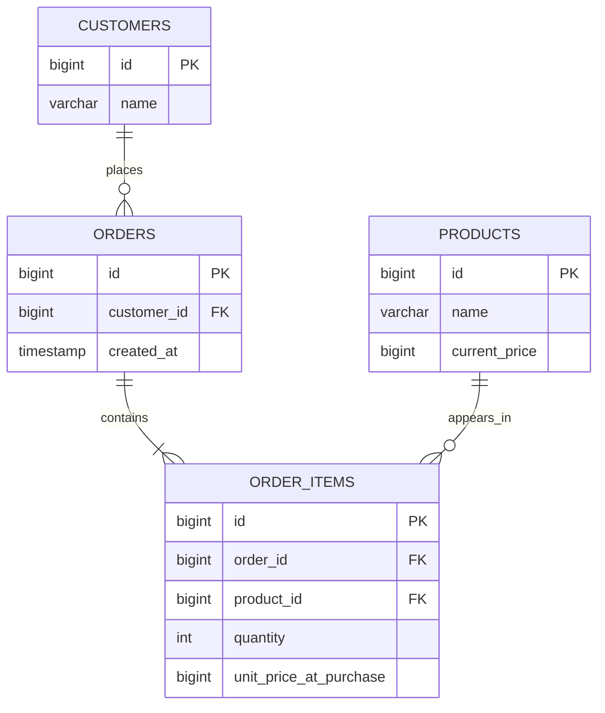

## معماری از فهم مسئله شروع می‌شود
برای نزدیک شدن به معماری نرم‌افزار، لازم نیست از نام الگوها و نمودار سرویس‌ها شروع کنیم. می‌توان چند پرسش ساده‌تر مطرح کرد: سیستم چه کاری انجام می‌دهد؟ چه اطلاعاتی را نگه می‌دارد؟ مسئولیت هر بخش چیست؟ و تغییر یک بخش، چه بخش‌های دیگری را درگیر می‌کند؟ منظور از «چند گام کوچک سطحی» در این نوشته، همین نگاه مقدماتی است؛ مرور چند تصمیم ملموس، پیش از ورود به جزئیات الگوهای معماری.

در تمام این گام‌ها، یک فروشگاه کوچک را در نظر می‌گیریم. مشتری کالا انتخاب می‌کند، سفارشی ثبت می‌شود و پرداخت آن پیگیری می‌شود. فعلاً همه‌ی این کارها در یک برنامه انجام می‌شوند. مسئله‌ی ما انتخاب میان یکپارچه و میکروسرویس نیست؛ می‌خواهیم بفهمیم همین برنامه‌ی کوچک چگونه می‌تواند ساختاری قابل‌فهم داشته باشد.

برای تصمیم گرفتن، محدودیت‌ها را هم باید بشناسیم. یک تیم دو نفره، زمان تحویل کوتاه و نیاز به ثبت سازگار سفارش، انتخاب‌های متفاوتی نسبت به چند تیم مستقل ایجاد می‌کنند. معماری از نسبت میان مسئله و این محدودیت‌ها شکل می‌گیرد؛ نه صرفاً از انتخاب ابزار محبوب‌تر.

## ابتدا موجودیت بعد کار
مثل «اول ایمنی، بعد کار»، پیش از شروع پیاده‌سازی باید بدانیم با چه موجودیت‌هایی سروکار داریم و رابطه‌ی آن‌ها چیست. در همان فروشگاه، «مشتری»، «سفارش»، «قلم سفارش» و «کالا» موجودیت‌های جداگانه‌اند: هر مشتری می‌تواند چند سفارش داشته باشد و هر سفارش شامل چند قلم است که هرکدام به یک کالا اشاره می‌کنند. در یک مدل رابطه‌ای، جدول سفارش با کلید خارجی به مشتری وصل می‌شود و جدول قلم سفارش، ارتباط سفارش و کالا را همراه با تعداد و قیمت هنگام خرید نگه می‌دارد؛ بنابراین تغییر قیمت فعلی کالا، مبلغ سفارش قبلی را عوض نمی‌کند. روشن کردن این موجودیت‌ها، رابطه‌ها و قواعدشان پیش از نوشتن منطق کار، کمک می‌کند مسئولیت‌ها را درست تقسیم کنیم و هنگام توسعه با داده‌های مبهم و وابستگی‌های ناخواسته روبه‌رو نشویم.

این مدل رابطه‌ای در نمودار زیر نمایش داده شده است:



هر مشتری می‌تواند چند سفارش داشته باشد؛ هر سفارش دست‌کم یک قلم دارد و هر قلم دقیقاً به یک کالا مربوط است. علامت `PK` کلید اصلی و `FK` کلید خارجی را مشخص می‌کند. قیمت جاری در `products.current_price` قرار دارد، اما قیمت هر واحد کالا هنگام خرید در `order_items.unit_price_at_purchase` ثبت می‌شود؛ مبلغ هر قلم برابر تعداد ضرب‌در همین قیمت ثبت‌شده است. همه‌ی مبلغ‌ها عدد صحیح و با یک واحد پولی ثابت‌اند. برای سادگی، تخفیف، مالیات و هزینه‌ی ارسال در این مدل نیامده‌اند.

## مرز بندی‌های کد توسعه را کنترل کند
وقتی مسئولیت هر بخش روشن شد، این مرزها باید در خود کد هم دیده شوند؛ وگرنه با اولین تغییر فوری، هر قسمت می‌تواند به جزئیات داخلی قسمت دیگر وابسته شود. اگر قواعد معماری فقط در یک سند یا در ذهن اعضای تیم باشند، رعایت آن‌ها به حافظه و دقت افراد وابسته می‌ماند. اما وقتی هر ماژول تنها از طریق یک رابط مشخص در دسترس باشد و وابستگی‌های مجاز با ساختار بسته‌ها، سطح دسترسی و بررسی خودکار محدود شوند، کد مسیر توسعه را هدایت می‌کند: افزودن یک قابلیت تازه باید از قراردادهای روشن عبور کند، نه از میان‌بری که مسئولیت‌ها را در هم می‌آمیزد. هدف این کنترل، کند کردن توسعه نیست؛ محدود کردن دامنه‌ی اثر تغییرهاست تا بتوانیم یک بخش را با اطمینان بیشتری تغییر دهیم، بدون آنکه ناخواسته رفتار بخش‌های دیگر را بشکنیم.

برای مثال، ماژول سفارش نباید مستقیماً جدول‌های پرداخت را تغییر دهد. یک قرارداد کوچک اجازه می‌دهد جزئیات پرداخت بعدها تغییر کند، بدون آنکه قواعد سفارش دوباره نوشته شوند.

```typescript
interface PaymentGateway {
  reserve(orderId: string, amount: number): Promise<string>;
}

async function checkout(gateway: PaymentGateway) {
  const paymentId = await gateway.reserve("order-42", 250000);
  return { paymentId, status: "pending" };
}
```

در این مثال، ماژول سفارش تنها می‌داند برای درخواست پرداخت باید چه اطلاعاتی بدهد و چه نتیجه‌ای دریافت کند. لازم نیست نام جدول‌های پرداخت یا جزئیات ارتباط با ارائه‌دهنده را بشناسد. مبلغ نمونه، عددی صحیح با واحد پولی ثابت است؛ در برنامه‌ی واقعی باید از اقلام و قیمت‌های ثبت‌شده‌ی همان سفارش محاسبه شود. به این ترتیب، شناخت موجودیت‌ها در گام قبل به تعیین ورودی این قرارداد کمک می‌کند.

البته نوشتن یک `interface` به‌تنهایی مرز را ایجاد نمی‌کند. اگر ماژول سفارش همچنان بتواند پیاده‌سازی داخلی پرداخت را وارد کند یا جدول‌های آن را تغییر دهد، این قرارداد بیشتر یک توصیه است. ساختار بسته‌ها، محدود کردن دسترسی به جزئیات داخلی و بررسی وابستگی‌ها باید کمک کنند مسیر مجاز، همان مسیر طبیعی توسعه باشد.

## مرز را با یک تغییر کوچک امتحان کنیم
حالا فرض کنیم ارائه‌دهنده‌ی پرداخت فروشگاه عوض شده است. کدام قسمت‌ها باید تغییر کنند؟ اگر قرارداد و معنای نتیجه‌ی آن ثابت مانده باشند، انتظار داریم بیشتر تغییرها در پیاده‌سازی پرداخت رخ دهند و قواعد ثبت سفارش دست‌نخورده بمانند. اگر برای این جابه‌جایی ناچاریم چندین بخش نامرتبط را اصلاح کنیم، احتمالاً جزئیات پرداخت از مرزش عبور کرده‌اند.

این پرسش، راهی ساده برای ارزیابی معماری است: آیا دامنه‌ی تغییر با مسئولیت بخشی که تغییر کرده تناسب دارد؟ قرار نیست هر تغییر فقط به یک فایل محدود شود. تغییر واقعی در قواعد کسب‌وکار ممکن است چند بخش را درگیر کند؛ مسئله، وابستگی‌هایی است که بدون ضرورت این دامنه را بزرگ می‌کنند.

برای آزمودن همین مثال، می‌توان در آزمون ماژول سفارش یک پیاده‌سازی جایگزین از `PaymentGateway` قرار داد. اگر بررسی رفتار سفارش به پایگاه داده‌ی پرداخت یا ارتباط با ارائه‌دهنده‌ی واقعی وابسته نباشد، مرز ماژول در عمل نیز مفید واقع شده است. البته رفتار خودِ پیاده‌سازی پرداخت و سازگاری آن با قرارداد، به بررسی جداگانه نیاز دارد.

## دلیل مرزبندی را فراموش نکنیم
پس از تعیین مرز، یک یادداشت کوتاه بنویسیم: چرا سفارش و پرداخت را جدا کردیم؟ چه چیزی باید پشت این مرز پنهان بماند؟ چه زمانی ممکن است لازم باشد قرارداد را تغییر دهیم؟ برای فروشگاه ما، پاسخ می‌تواند این باشد که تغییر ارائه‌دهنده‌ی پرداخت نباید قواعد سفارش را تغییر دهد، اما اضافه شدن پرداخت چندمرحله‌ای احتمالاً نیازمند بازنگری در قرارداد است.

این یادداشت قرار نیست سندی مفصل باشد. کافی است نفر بعدی بداند تصمیم از کدام نیاز آمده است. بدون این توضیح، ممکن است مرز مفید را پیچیدگی بی‌دلیل تصور کند، یا برعکس، تصمیمی موقتی را قاعده‌ای همیشگی بداند.

## هر مسئله را در همان سطح حل کنیم
در این نقطه هنوز دلیلی برای تبدیل هر ماژول به یک سرویس مستقل نداریم. مرز کد به ما کمک کرده مسئولیت‌ها و وابستگی‌ها را روشن کنیم؛ جداسازی فرایند اجرا، تصمیم دیگری است و هزینه‌ها و نیازهای خودش را دارد. نباید نتیجه‌ی گام‌های ساده‌ی قبلی را با افزودن اجزایی که هنوز مسئله‌ای برایشان نداریم، پیچیده کنیم.

حتی در همین برنامه‌ی کوچک نیز می‌توان با دیدن نشانه‌ها تصمیم گرفت قدم بعدی چیست:

| نشانه در فروشگاه | پرسش یا اقدام اولیه |
| --- | --- |
| تغییر پرداخت، ثبت سفارش را هم خراب می‌کند | کدام جزئیات از مرز ماژول عبور کرده‌اند؟ |
| تغییر قیمت کالا، مبلغ سفارش قبلی را عوض می‌کند | آیا قیمت هنگام خرید در قلم سفارش ثبت شده است؟ |
| آزمون سفارش به درگاه واقعی نیاز دارد | آیا وابستگی پرداخت از طریق قرارداد قابل جایگزینی است؟ |

این‌ها پاسخ نهایی تمام مسائل معماری نیستند؛ تمرین‌هایی کوچک برای دیدن ساختار سیستم‌اند. شناخت مسئله، روشن کردن موجودیت‌ها، مشخص کردن مرزها و امتحان کردن آن‌ها با یک تغییر واقعی، نقطه‌ی شروع قابل‌استفاده‌ای به ما می‌دهد. پس از آن، هر تصمیم تازه باید پاسخی به یک نیاز روشن باشد.

> برای فهم بهتر معماری، ابتدا ببینیم هر بخش چه مسئولیتی دارد و تغییر آن تا کجا اثر می‌گذارد.
